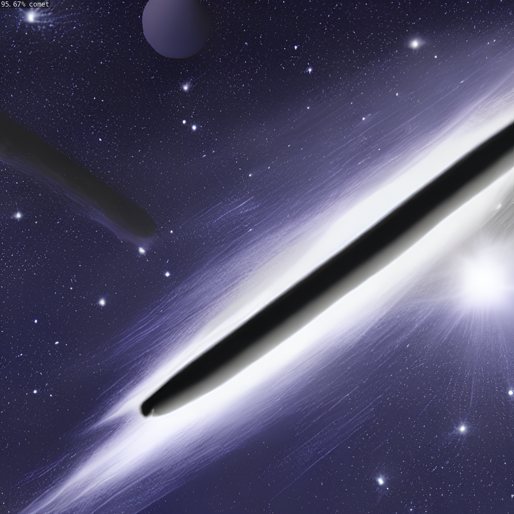

# Spacenet

 Spacenet is an image classification model that takes a picture of space and identifies the primary celestial object included in it.

## The Algorithm

spacenet used transfer learning, which takes an existing model and trains it on new data. Transfer learning allows for the model to train much faster. The original model was resnet18, a convolutional neural network, which utilizes residual connections to solve the vanishing gradient problem due to weakening influence on the weights of neural connections during back propagation. We trained resnet 18 on hundreds of images of celestial objects, categorized as asteroids, comets, black holes, planets, stars, constellations, and nebulae. This is what gave spacenet it's ability to reliably differentiate between them.

## Running this project
1. install the jetson-inference library using their instructions
2. change directory into harry_finalproject by typing "cd harry_finalproject" into the terminal
3. find an image file from one of the subfolders in the test_images folder
4. type "python3 spacenet.py test_images/(subfolder)/(image file name)" into the terminal to run the model on your chosen image

[View a video explanation here](https://drive.google.com/file/d/1ZjYmLmER7vYg7t6RRrXMQORvI4466Cz1/view?usp=sharing)
